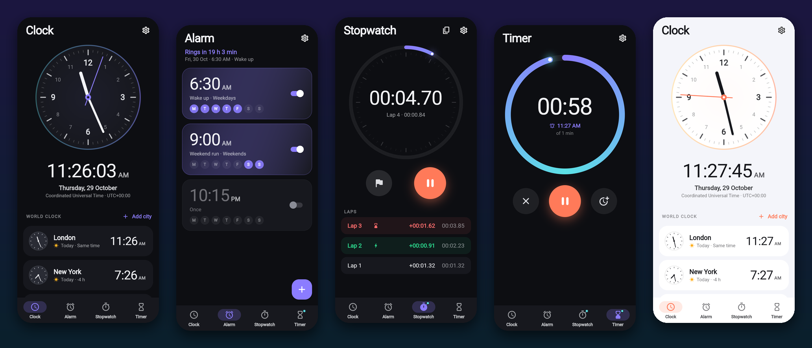
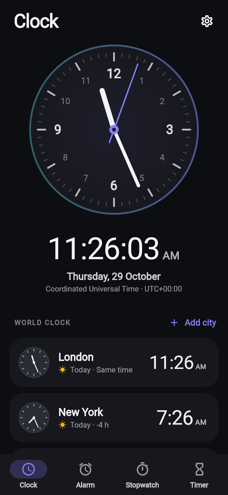
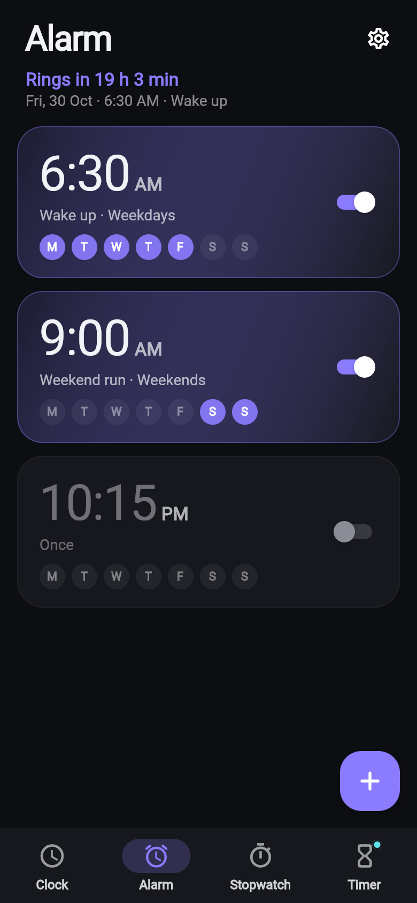
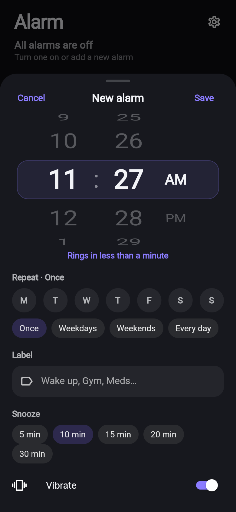
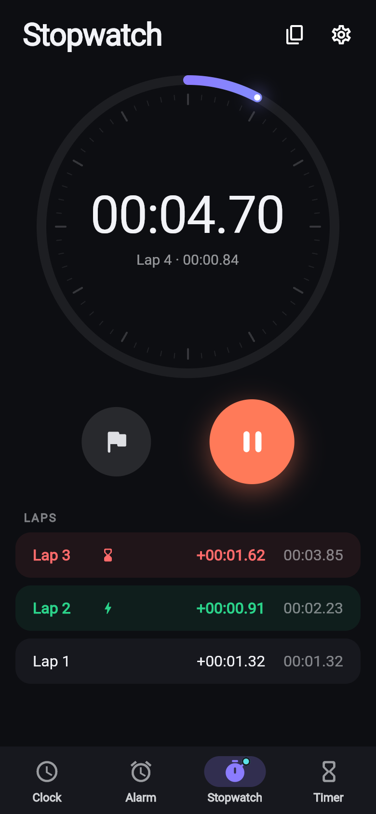
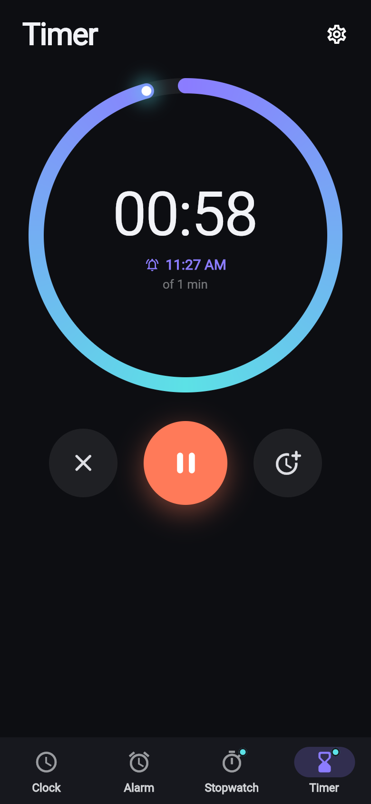
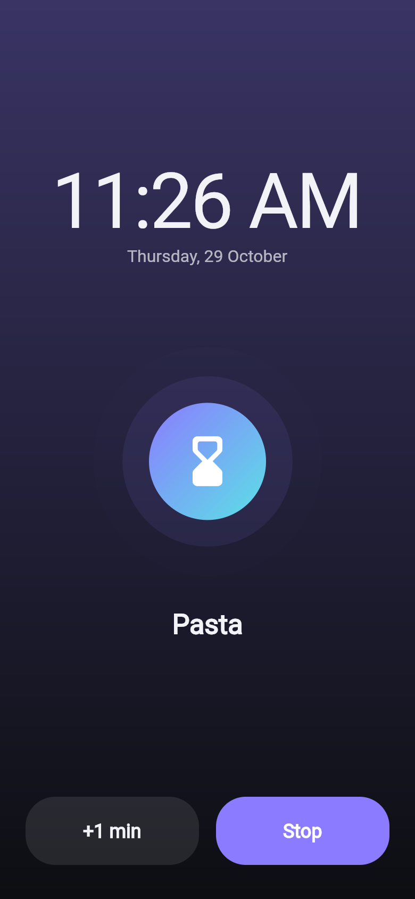
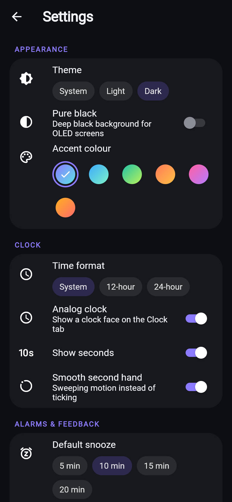
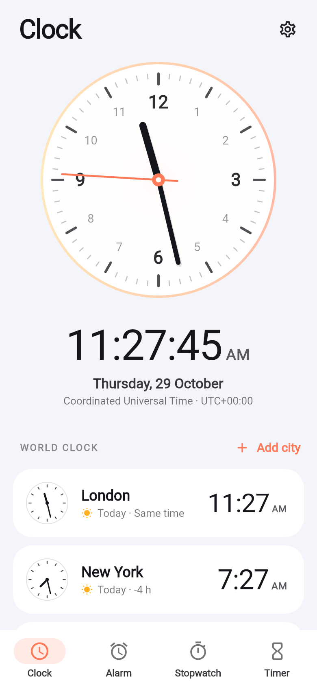

<div align="center">

# ⏰ Best Clock

**A beautiful, reliable clock app for Android: world clock, alarms, stopwatch and timer, all in one place.**

[](https://github.com/ChandraChaan/timerApp/releases/latest/download/best-clock.apk)
[](https://github.com/ChandraChaan/timerApp/releases/latest)
[](https://github.com/ChandraChaan/timerApp/actions/workflows/release-apk.yml)


[](https://github.com/ChandraChaan/timerApp/stargazers)



</div>

## 📥 Download

1. Download **[best-clock.apk](https://github.com/ChandraChaan/timerApp/releases/latest/download/best-clock.apk)** on your Android phone
   (or pick a version from [Releases](https://github.com/ChandraChaan/timerApp/releases)).
2. Open it and allow **Install unknown apps** if Android asks.
3. Allow notifications so alarms and timers can ring.

## ✨ Features

| | |
|---|---|
| 🕰️ **Clock** | Big analog face with a smooth sweeping second hand, digital time, date and your time zone |
| 🌍 **World clock** | Add any city on earth, with day/night, "Today/Tomorrow" and hour differences. Swipe to remove, long-press to reorder |
| ⏰ **Alarms** | Wheel time picker, repeat days, labels, snooze length, vibration. Rings even when the app is closed and after a reboot |
| 😴 **Snooze & dismiss** | Full-screen ringing page; one-time alarms switch themselves off |
| ⏱️ **Stopwatch** | Hundredths of a second, laps with fastest/slowest highlighted, copy laps; keeps running when the app is closed |
| ⏳ **Timer** | Hours/minutes/seconds wheel, quick starts and recent timers, progress ring, pause / +1 min, full-screen "Time's up" |
| 🎨 **Themes** | Dark, light, system and pure-black OLED modes, plus six accent colours |
| ⚙️ **Settings** | 12/24-hour time, analog/digital clock, show seconds, default snooze, haptic feedback |

## 📱 Screenshots

<div align="center">

| Clock | Alarms | New alarm | Stopwatch |
|:---:|:---:|:---:|:---:|
|  |  |  |  |

| Timer | Time's up | Settings | Light theme |
|:---:|:---:|:---:|:---:|
|  |  |  |  |

</div>

## 🛠️ Build it yourself

Requires Flutter 2.10 (Dart 2.16) and Java 11.

```sh
git clone https://github.com/ChandraChaan/timerApp.git
cd timerApp
flutter pub get
flutter test
flutter run                  # run on a connected phone
flutter build apk --release  # build/app/outputs/flutter-apk/app-release.apk
```

### Publishing a new release

Every push builds the APK in GitHub Actions. Every build of `main` publishes a
GitHub Release named after the `version` in `pubspec.yaml` (for example
`version: 2.1.0+3` → release `v2.1.0`) with `best-clock.apk` attached.
To ship a new version, bump `version` and merge to `main`.

## 🗂️ Project structure

```
lib/
  main.dart          app start-up
  app.dart           MaterialApp and themes
  core/              formatting helpers and theme
  models/            Alarm, WorldCity (+ curated city list)
  services/          notifications, time zones, Firebase messaging
  state/             controllers for settings, alarms, stopwatch, timer, world clock
  ui/screens/        Clock, Alarm, Stopwatch, Timer, Settings, ringing page
  ui/widgets/        analog clock, progress ring, wheel picker, ...
test/                unit and widget tests
```

## 🤝 Contributing

Issues and pull requests are welcome! If you like the app, please **⭐ star the repo**. It helps others find it.
